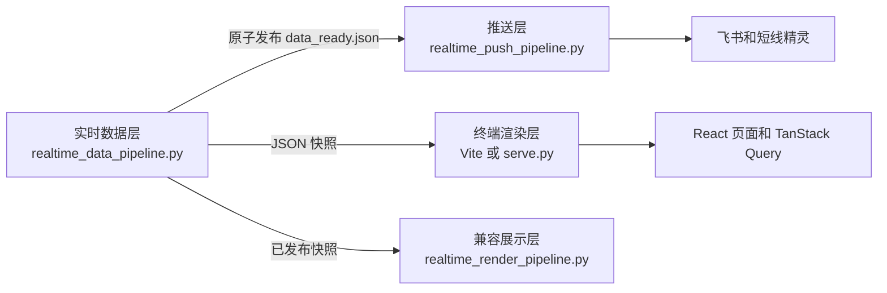

# 盘中实时三层链路

终端只展示已发布的数据。采集、推送和渲染之间不允许反向调用。

## 实时数据层

负责抓取行情并生成 `latest.json`、候选、反馈矩阵、五日线、情绪时间轴和题材轮动实时快照。完成后写入 `cache/pulse_snapshots/data_ready.json`。

只有行情、反馈矩阵和实时题材轮动均成功，且题材轮动的 `source_ts` 与 `latest.json.ts` 相同，标记才为 `ready: true`。失败时记录每一步退出码，保留失败原因，禁止下游把旧数据当作新数据使用。

## 推送层

只读取 `data_ready.json`，且要求源行情快照不超过 120 秒。满足条件后才运行短线精灵、精选快讯和盘中节拍。它不抓行情、不计算候选、不改写决策或执行账本。

## 终端渲染层

React 终端通过只读 `/api/*` 读取 JSON；Vite 与生产 `serve.py` 都使用同一套路由语义和 `Cache-Control: no-store`。页面轮询只会重新取数，绝不触发采集或推送。

旧 `dashboard.html`、`watch.html` 由兼容展示层生成，同样只在数据层发布成功后读取快照。
